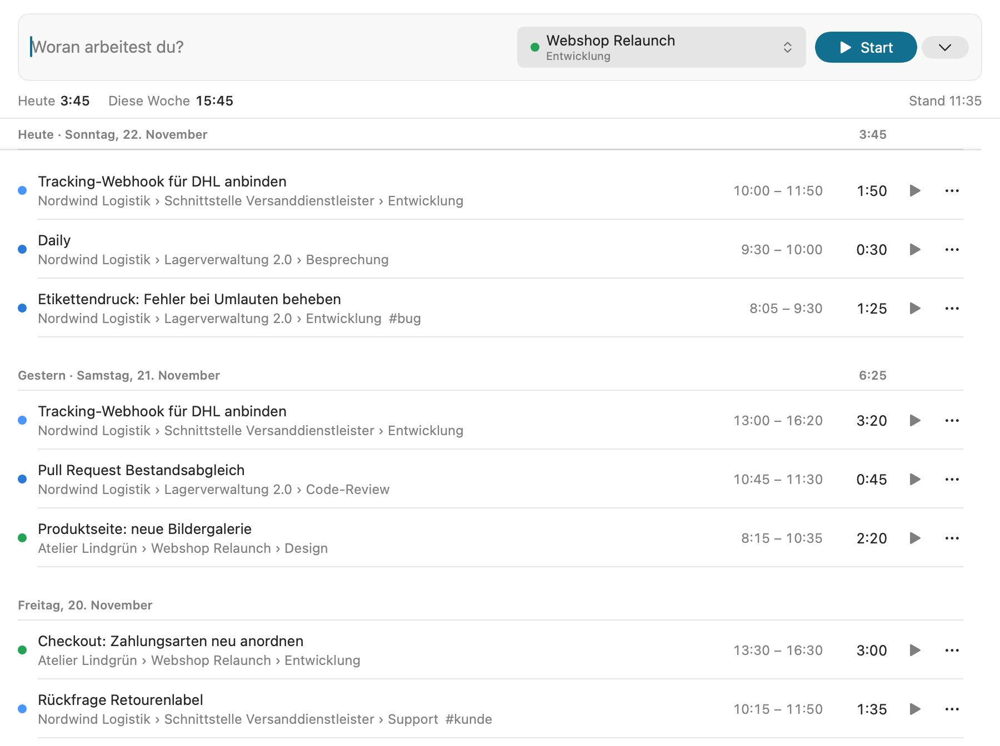
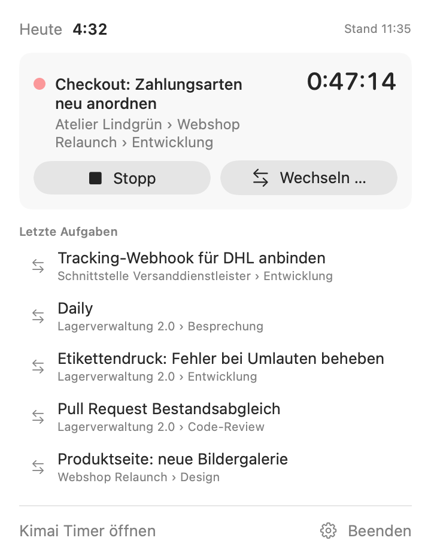
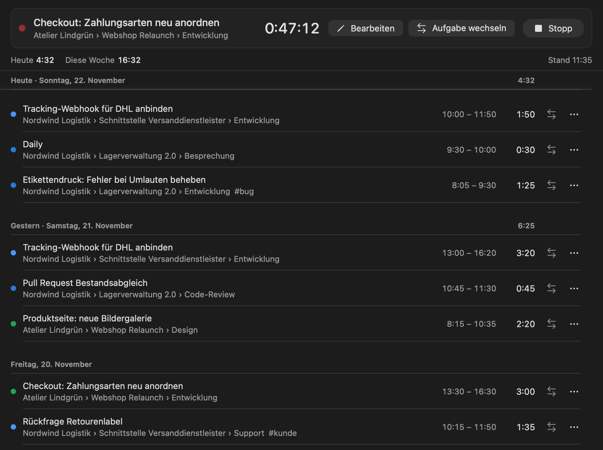
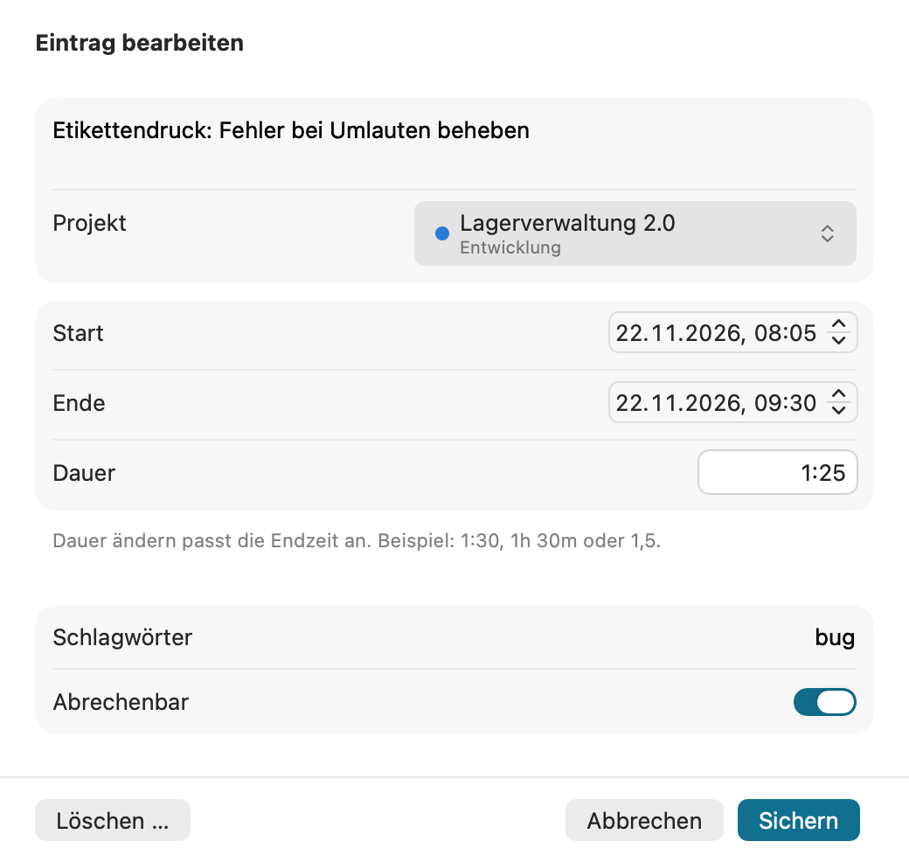
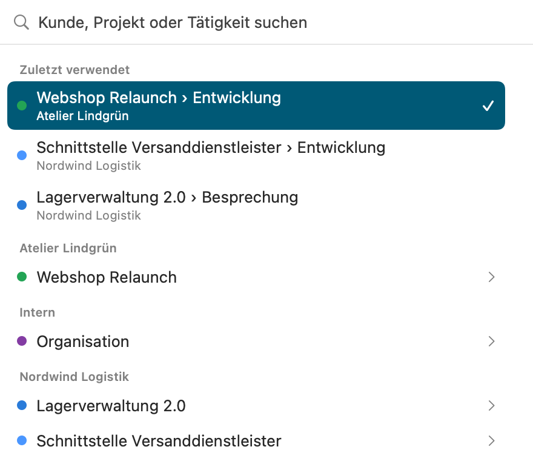
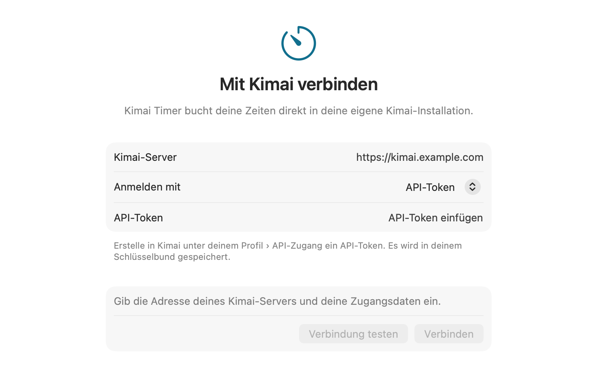
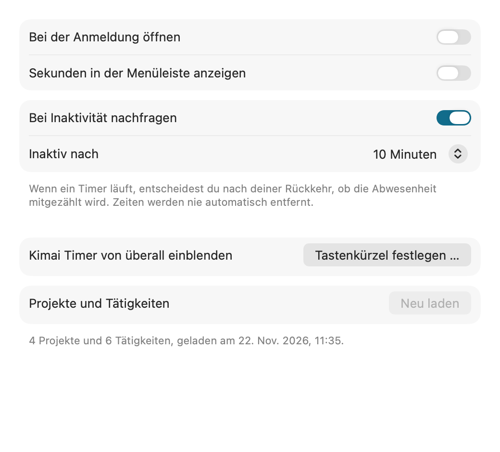

# Kimai Timer für macOS

Eine native macOS-App zur Zeiterfassung in deiner eigenen [Kimai](https://www.kimai.org)-Installation: Timer aus der Menüleiste starten, wechseln und stoppen, Einträge nachträglich korrigieren und die Summen für heute und diese Woche im Blick behalten.

*English version: [README.md](README.md)*



Kimai Timer ist in Swift und SwiftUI geschrieben. Die App spricht direkt mit der REST-API deines Kimai-Servers und mit sonst nichts: kein Konto, keine Telemetrie, kein Update-Server.

## Funktionen

- **Timer in der Menüleiste** – die laufende Zeit ist immer sichtbar; stoppen, wechseln oder eine der letzten Aufgaben neu starten, ohne ein Fenster zu öffnen.
- **Start startet sofort** – eintippen, woran du arbeitest, und Enter drücken. Projekt und Tätigkeit werden vom letzten Timer übernommen.
- **Eine Auswahl für alles** – Kunde, Projekt und Tätigkeit in einem Feld durchsuchen; zuletzt verwendete Kombinationen stehen oben.
- **Wechseln ohne Zeitverlust** – der neue Timer wird zuerst angelegt, der vorherige endet genau dort, wo der neue beginnt. Mit „Früher starten …“ gibst du an, wann du wirklich gewechselt hast.
- **Einträge korrigieren** – native Datums- und Zeitfelder und ein Dauerfeld, das `1:30`, `1h 30m`, `90m` und `1,5` versteht. An Kimai gehen nur die Felder, die du geändert hast.
- **Übersicht** – Einträge nach Tagen mit Summen, heute und diese Woche (inklusive laufendem Timer), Suche und Nachladen früherer Einträge.
- **Inaktivität** – warst du weg, während ein Timer lief, entscheidest du, was mit dieser Zeit geschieht. Es wird nichts automatisch entfernt.
- **Mac-Komfort** – globales Tastenkürzel, Start bei der Anmeldung, heller und dunkler Modus, VoiceOver-Beschriftungen, Deutsch und Englisch.

| Menüleiste | Laufender Timer (dunkel) |
| --- | --- |
|  |  |

| Eintrag bearbeiten | Projekt- und Tätigkeitsauswahl |
| --- | --- |
|  |  |

## Voraussetzungen

- macOS 14 (Sonoma) oder neuer, Apple-Chip oder Intel
- Ein per HTTPS erreichbarer Kimai-2-Server (entwickelt gegen Kimai 2.60 und 2.72)
- Ein API-Token aus Kimai (dein Profil › API-Zugang). Die ältere Kombination aus Benutzername und API-Passwort wird ebenfalls unterstützt.

## Installation

Das Release ist ad hoc signiert und **nicht von Apple notarisiert** (dafür wäre eine kostenpflichtige Apple-Developer-Mitgliedschaft nötig). macOS öffnet eine mit dem Browser geladene Kopie deshalb erst, nachdem du sie einmal freigegeben hast. Such dir einen Weg aus:

### Weg A – im Browser laden

1. `Kimai-Timer.zip` aus dem [aktuellen Release](https://github.com/kruegge82/KimaiMacOs/releases/latest) laden, entpacken und **Kimai Timer** in den Ordner „Programme“ bewegen.
2. Einmal öffnen. macOS meldet *„Apple konnte nicht überprüfen, ob ‚Kimai Timer‘ frei von Schadsoftware ist …“* und bietet nur **Fertig** und **In den Papierkorb legen** an. **Fertig** wählen – in diesem Dialog gibt es keine Schaltfläche zum Öffnen.
3. **Systemeinstellungen › Datenschutz & Sicherheit** öffnen und ganz nach unten zum Abschnitt **Sicherheit** scrollen. Dort steht *„‚Kimai Timer‘ wurde blockiert, um deinen Mac zu schützen“* mit der Schaltfläche **Dennoch öffnen**. Anklicken und mit Passwort oder Touch ID bestätigen.
   Die Schaltfläche erscheint erst nach Schritt 2 und verschwindet nach etwa einer Stunde wieder; ist sie weg, Schritt 2 wiederholen.

Danach startet die App ganz normal.

### Weg B – per Terminal installieren

Mit `curl` geladene Dateien landen nicht in der Quarantäne, die Freigabe entfällt:

```sh
curl -L -o /tmp/Kimai-Timer.zip https://github.com/kruegge82/KimaiMacOs/releases/latest/download/Kimai-Timer.zip \
  && ditto -x -k /tmp/Kimai-Timer.zip /Applications \
  && open "/Applications/Kimai Timer.app"
```

Schon mit dem Browser geladen? Dann entfernt dieser Befehl die Quarantäne-Markierung:
`xattr -dr com.apple.quarantine "/Applications/Kimai Timer.app"`

Beide Varianten überspringen Apples Schadsoftware-Prüfung; nutze sie also nur für einen Download, dem du vertraust. Jedes Release nennt die SHA-256-Prüfsumme des Archivs.

### Weg C – selbst bauen

[Aus dem Quellcode bauen](#aus-dem-quellcode-bauen) geht mit einem Befehl und ergibt eine App, die ohne jede Warnung startet.

## Erste Schritte



1. Adresse deines Kimai-Servers eingeben, zum Beispiel `https://kimai.example.com`.
2. Anmeldeart wählen:
   - **API-Token** – in Kimai unter deinem Profil › API-Zugang erstellen (ab Kimai 2.14).
   - **Benutzername und API-Passwort** – die ältere Methode für Server oder Konten, die sie noch nutzen.
3. Mit **Verbindung testen** prüfen, dann **Verbinden**.


### Im Alltag

| Aktion | So geht es |
| --- | --- |
| Timer starten | Beschreibung eintippen, Enter |
| Starten oder stoppen, egal wo in der App | ⌘↩ |
| Zu einer anderen Aufgabe wechseln | **Aufgabe wechseln** oder die Pfeiltaste eines früheren Eintrags |
| Rückwirkend starten | Pfeil neben **Start** › **Früher starten …** |
| Abgeschlossenen Eintrag hinzufügen | ⌘N |
| Eintrag bearbeiten | Doppelklick oder auswählen und Enter |
| Im Editor sichern / abbrechen | ⌘S oder Enter / Esc |
| Ausgewählten Eintrag löschen | ⌫ (mit Rückfrage) |
| Aktualisieren / Projekte neu laden | ⌘R / ⇧⌘R |
| Kimai im Browser öffnen | ⇧⌘K |
| Einstellungen | ⌘, |

Das Schließen des Fensters stoppt die Zeiterfassung nicht; die App läuft in der Menüleiste weiter. Ein globales Tastenkürzel zum Einblenden des Fensters lässt sich unter Einstellungen › Allgemein festlegen.



## Datenschutz und Sicherheit

- Das API-Token liegt im macOS-Schlüsselbund, nie in einer Datei oder in den Einstellungen der App.
- Die App läuft in der App Sandbox mit genau einem Recht: ausgehende Netzwerkverbindungen.
- Sie verbindet sich ausschließlich mit dem Kimai-Server, den du einträgst. Es gibt keine Analyse, keine Absturzberichte und keinen automatischen Updater.
- Adressen mit `http://` funktionieren nur für Rechner im lokalen Netzwerk, und die App warnt, dass das Token dann unverschlüsselt übertragen wird.
- Kunden, Projekte und Tätigkeiten werden lokal (im Sandbox-Container der App) zwischengespeichert, damit die App direkt nach dem Start nutzbar ist. **Verbindung trennen** entfernt Token und Zwischenspeicher.

## Gut zu wissen

- Timer lassen sich nur starten, stoppen oder ändern, solange der Kimai-Server erreichbar ist; die App merkt sich keine Änderungen für später.
- Ein Aufgabenwechsel besteht aus mehreren Anfragen. Bricht die Verbindung mittendrin ab, sagt die App, was sie nicht abschließen konnte; prüfe in dem Fall die betroffenen Einträge.
- Ein Wechsel kann nicht vor dem Beginn des laufenden Timers starten. Stoppe zuerst den laufenden Timer, wenn du frühere Zeit buchen möchtest.
- Kimai ignoriert stillschweigend Schlagwörter, die dein Konto nicht anlegen darf. Die App weist darauf hin.

## Aus dem Quellcode bauen

Voraussetzung: Xcode 16 oder neuer.

```sh
git clone https://github.com/kruegge82/KimaiMacOs.git
cd KimaiMacOs
scripts/build.sh Release
open "build/Build/Products/Release/Kimai Timer.app"
```

Das Skript signiert mit einem lokalen Entwicklerzertifikat, falls vorhanden, sonst ad hoc. Alternativ `KimaiTimer.xcodeproj` in Xcode öffnen und das Schema `KimaiTimer` starten.

Tests, Werkzeuge, Projektaufbau und Hinweise zur Kimai-API stehen in der [englischen README](README.md#tests-and-tools).

## Hinweis

Dies ist ein unabhängiges Projekt und steht in keiner Verbindung zu Kimai. Kimai ist eine Marke von Kevin Papst.

## Lizenz

[MIT](LICENSE)
