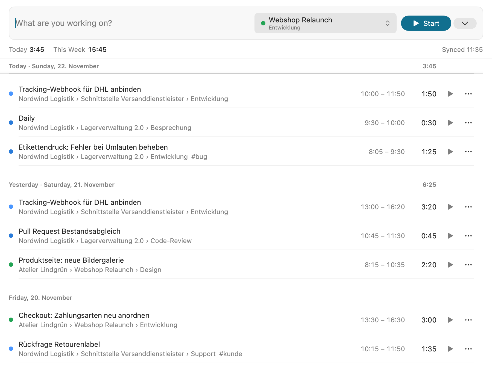
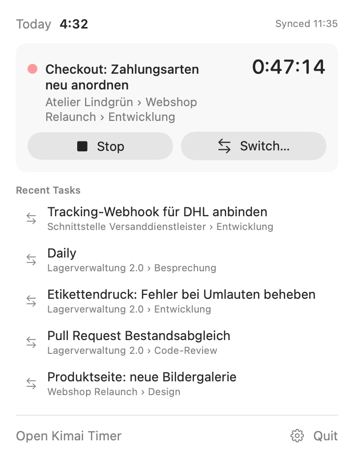
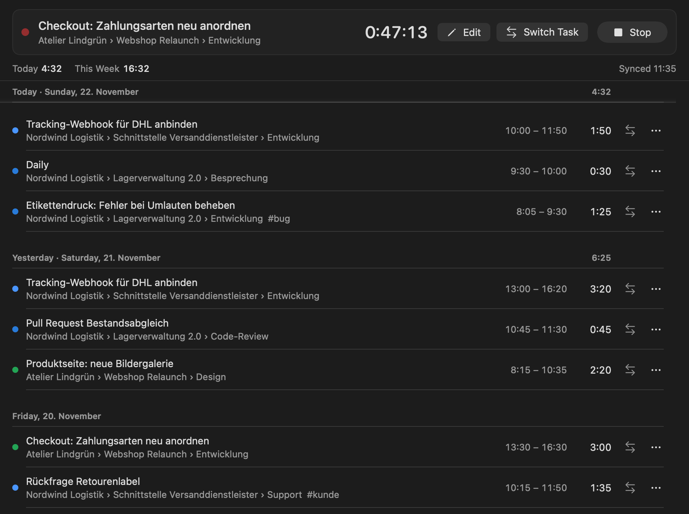
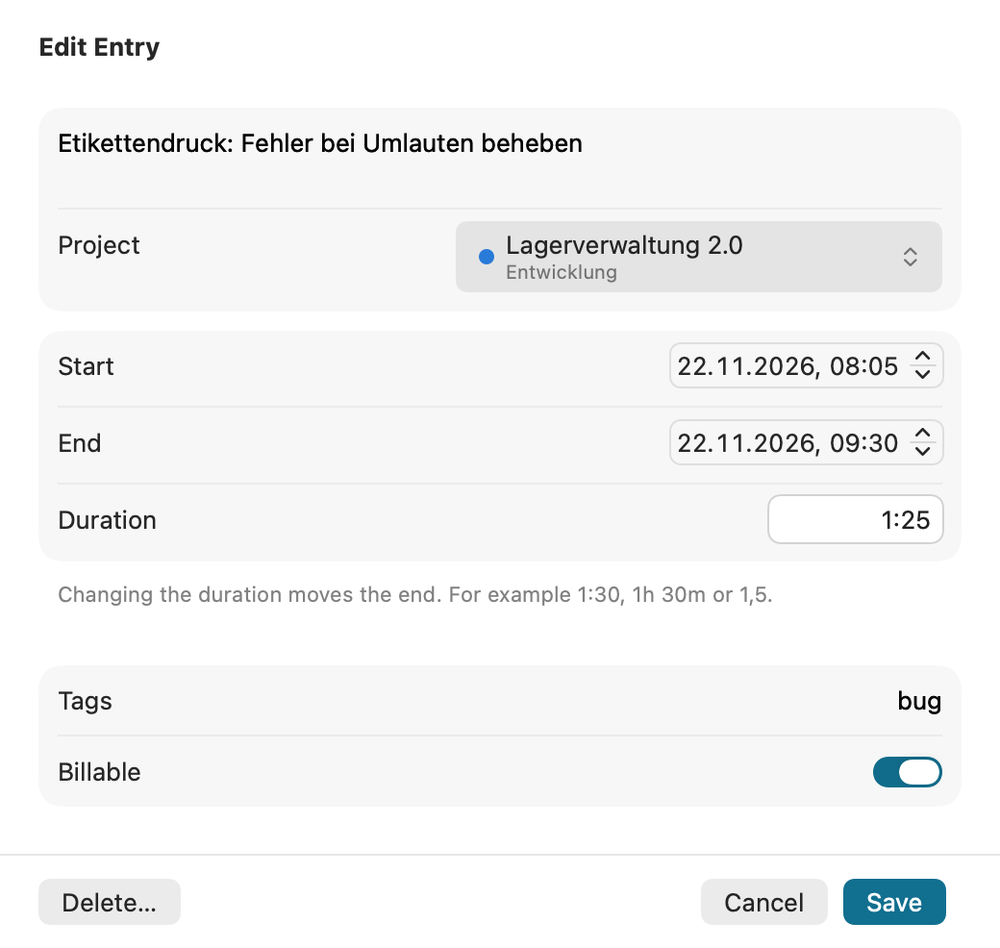
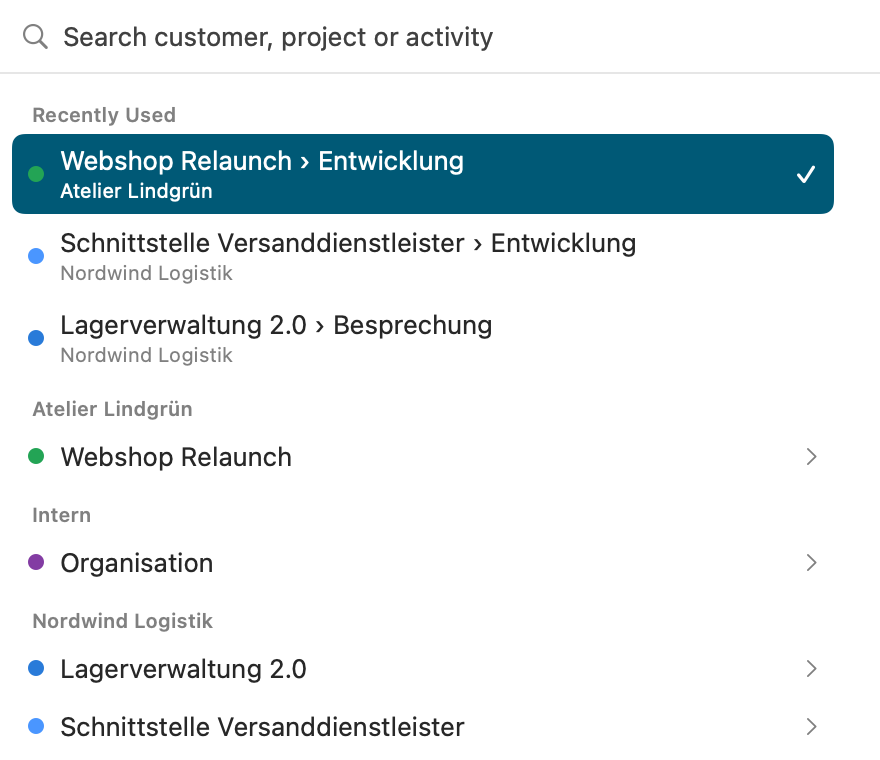
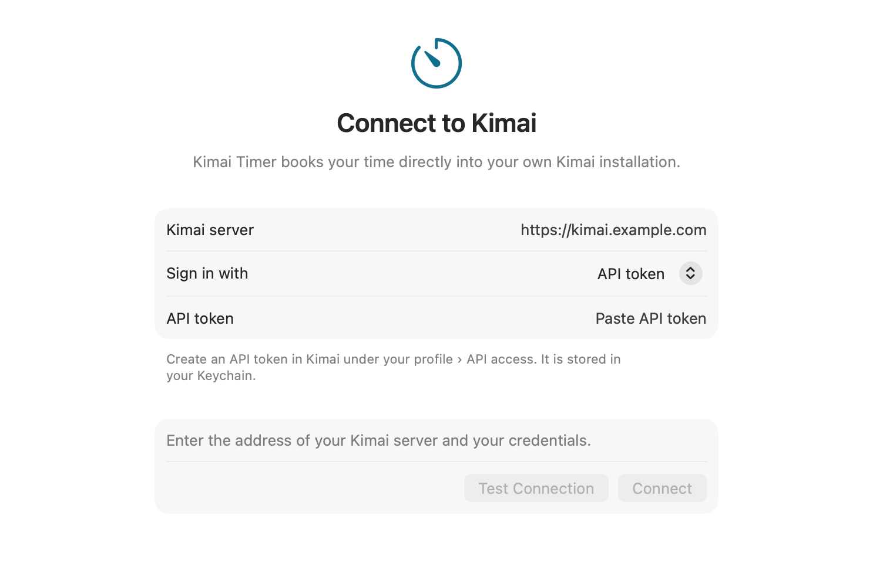
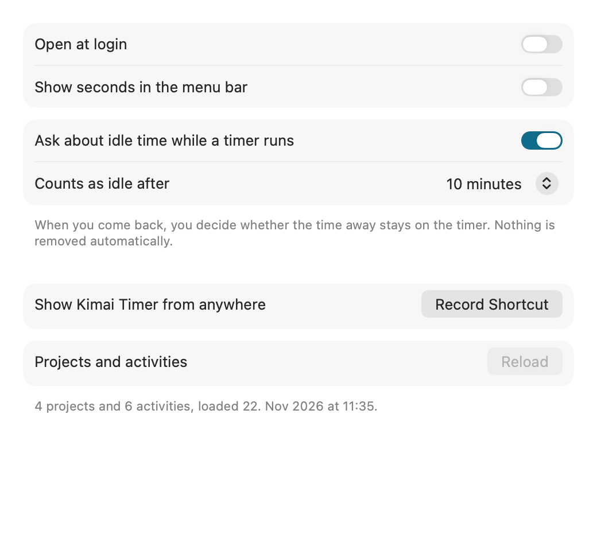

# Kimai Timer for macOS

A native macOS app for tracking time in your own [Kimai](https://www.kimai.org) installation: start, switch and stop timers from the menu bar, correct entries afterwards, and see today's and this week's totals at a glance.

*Deutsche Anleitung: [README.de.md](README.de.md)*



Kimai Timer is written in Swift and SwiftUI. It talks directly to the REST API of your Kimai server and to nothing else: no account, no telemetry, no update server.

## Features

- **Menu bar timer** – the elapsed time is always visible; stop, switch or restart a recent task without opening a window.
- **Start means start** – type what you are working on and press Return. Project and activity are remembered from the last timer.
- **One picker for everything** – search customer, project and activity in a single field; recently used combinations come first.
- **Switching without lost time** – the new timer is created first and the previous one ends exactly where the new one begins. "Start earlier…" lets you say when you really switched.
- **Fixing entries** – native date and time fields, and a duration field that understands `1:30`, `1h 30m`, `90m` and `1,5`. Only the fields you change are sent to Kimai.
- **Overview** – entries grouped by day with totals, today and this week (including the running timer), search, and loading of earlier entries.
- **Idle detection** – if you were away while a timer was running, you decide what happens with that time. Nothing is removed automatically.
- **Mac conveniences** – global keyboard shortcut, open at login, light and dark mode, VoiceOver labels, English and German.

| Menu bar | Running timer (dark) |
| --- | --- |
|  |  |

| Editing an entry | Project and activity picker |
| --- | --- |
|  |  |

## Requirements

- macOS 14 (Sonoma) or newer, Apple silicon or Intel
- A Kimai 2 server reachable over HTTPS (developed against Kimai 2.60 and 2.72)
- An API token from Kimai (your profile › API access). The older combination of user name and API password is supported as well.

## Installation

1. Download `Kimai-Timer-<version>.zip` from the [latest release](https://github.com/kruegge82/KimaiMacOs/releases/latest).
2. Unzip it and move **Kimai Timer** to your Applications folder.
3. Open it. The release is not notarized by Apple, so macOS blocks the first launch:
   open **System Settings › Privacy & Security**, scroll down and choose **Open Anyway** for Kimai Timer.
   Alternatively run `xattr -dr com.apple.quarantine "/Applications/Kimai Timer.app"` in Terminal.

If you prefer not to run a downloaded binary, [build the app yourself](#building-from-source); it takes one command.

## Getting started



1. Enter the address of your Kimai server, for example `https://kimai.example.com`.
2. Choose how to sign in:
   - **API token** – create one in Kimai under your profile › API access (Kimai 2.14 and newer).
   - **User name and API password** – the older method, for servers or accounts that still use it.
3. Choose **Test Connection** to check, then **Connect**.


### Daily use

| Action | How |
| --- | --- |
| Start a timer | Type a description, press Return |
| Start or stop from anywhere in the app | ⌘↩ |
| Switch to another task | **Switch Task**, or the arrow button of an earlier entry |
| Start in the past | The arrow next to **Start** › **Start Earlier…** |
| Add a finished entry | ⌘N |
| Edit an entry | Double-click it, or select it and press Return |
| Save / cancel in the editor | ⌘S or Return / Esc |
| Delete the selected entry | ⌫ (asks for confirmation) |
| Refresh / reload projects | ⌘R / ⇧⌘R |
| Open Kimai in the browser | ⇧⌘K |
| Settings | ⌘, |

Closing the window does not stop tracking; the app keeps running in the menu bar. A global shortcut for bringing up the window can be set in Settings › General.



## Privacy and security

- The API token is stored in your macOS Keychain, never in a file or in the app's preferences.
- The app runs in the App Sandbox with a single capability: outgoing network connections.
- It connects only to the Kimai server you enter. There is no analytics, crash reporting or automatic updater.
- Plain `http://` addresses work only for hosts on your local network, and the app warns that the token is then sent unencrypted.
- Customers, projects and activities are cached locally (inside the app's sandbox container) so the app is usable right after launch. **Disconnect** removes the token and that cache.

## Good to know

- Timers can only be started, stopped or changed while the Kimai server is reachable; the app does not queue changes offline.
- Switching tasks takes a few requests. If the connection drops in the middle, the app tells you what it could not finish; check the affected entries in that case.
- A switch cannot begin before the running timer began. Stop the running timer first if you need to book earlier time.
- Kimai silently ignores tags your account may not create. The app tells you when that happens.

## Building from source

Requirements: Xcode 16 or newer.

```sh
git clone https://github.com/kruegge82/KimaiMacOs.git
cd KimaiMacOs
scripts/build.sh Release
open "build/Build/Products/Release/Kimai Timer.app"
```

The script signs with a local development certificate if you have one and ad hoc otherwise. You can also open `KimaiTimer.xcodeproj` in Xcode and run the `KimaiTimer` scheme.

### Tests and tools

```sh
# Unit tests of the API client and the logic
cd Packages/KimaiKit && swift test

# The same plus a real round trip against the public Kimai demo (creates and deletes test entries there)
KIMAI_LIVE_TEST=1 swift test

# End-to-end check of the app logic against the public Kimai demo
scripts/snapshots.sh /tmp/kimai-shots   # builds the unsandboxed debug copy used below
"build/snapshots/Build/Products/Debug/Kimai Timer.app/Contents/MacOS/Kimai Timer" --smoke-demo

# Render the main views with sample data into PNG files
scripts/snapshots.sh docs/screenshots/raw en

# Verify that every user-facing string has a German translation
scripts/check-l10n.py

# Build the distributable archive (universal, signed ad hoc) into build/release
scripts/release.sh
```

### Project layout

| Path | Contents |
| --- | --- |
| `Packages/KimaiKit` | Swift package without UI: Kimai API client, models, project/activity search, duration parsing, grouping. Fully unit tested. |
| `KimaiTimer/App` | App entry point, menus, app delegate |
| `KimaiTimer/Model` | `AppModel` (state, loading, actions), editor form logic, preferences |
| `KimaiTimer/Services` | Keychain, catalog cache, idle detection, global hot key, open at login |
| `KimaiTimer/Views` | SwiftUI views: main window, timer bar, picker, editor, menu bar panel, settings |
| `KimaiTimer/Debug` | Development-only: sample data, snapshot renderer, smoke test (not compiled into release builds) |
| `KimaiTimer/Localizable.xcstrings` | German translations (English is the source language) |
| `scripts` | Build, release archive, snapshots, icon generation, translation check |

### Notes on the Kimai API

A few things that are easy to get wrong and that this client handles:

- Kimai returns timestamps with an offset but expects local times **without** offset when writing, interpreted in the time zone of the user's Kimai profile. The app therefore loads the profile first and refuses to write before the zone is known.
- Collection endpoints return related entities as ids, detail endpoints as nested objects; both are accepted.
- Updates send only changed fields. Sending `billable` is rejected for accounts without that permission, and unchanged times would otherwise lose their seconds.
- Tags an account may not create are dropped silently by Kimai; the app tells you when that happens.

## Disclaimer

This is an independent project and not affiliated with or endorsed by Kimai. Kimai is a trademark of Kevin Papst.

## License

[MIT](LICENSE)
